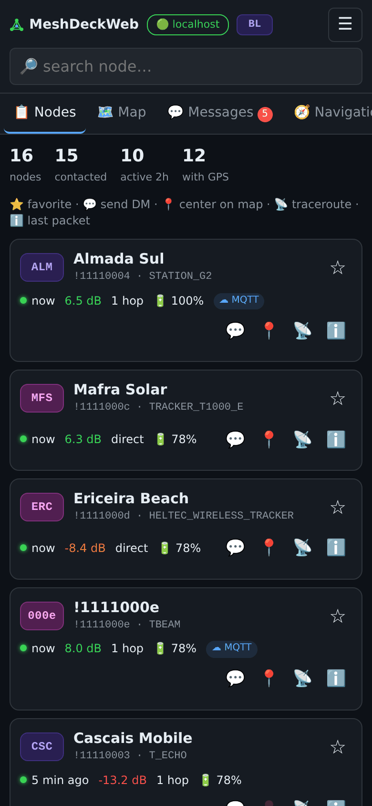
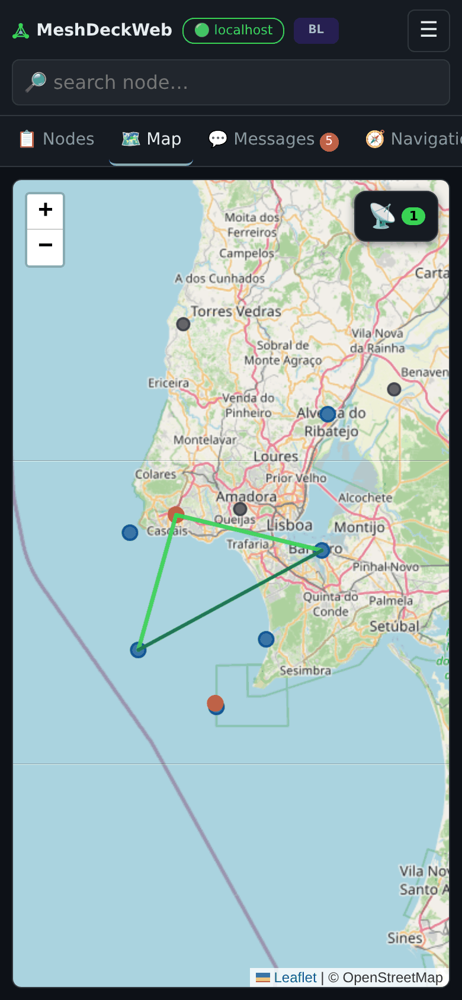
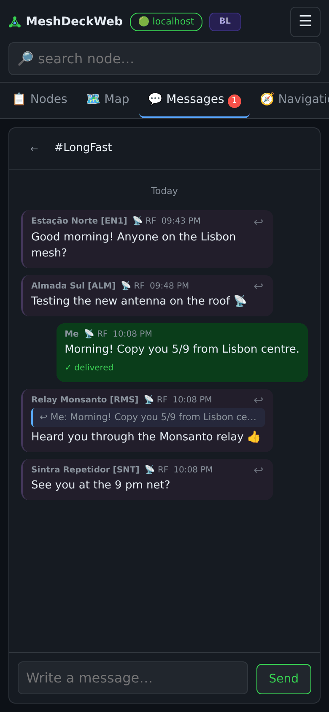
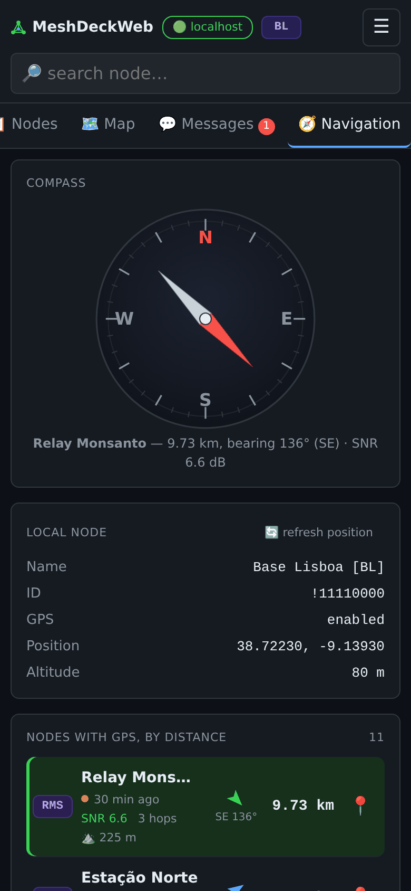
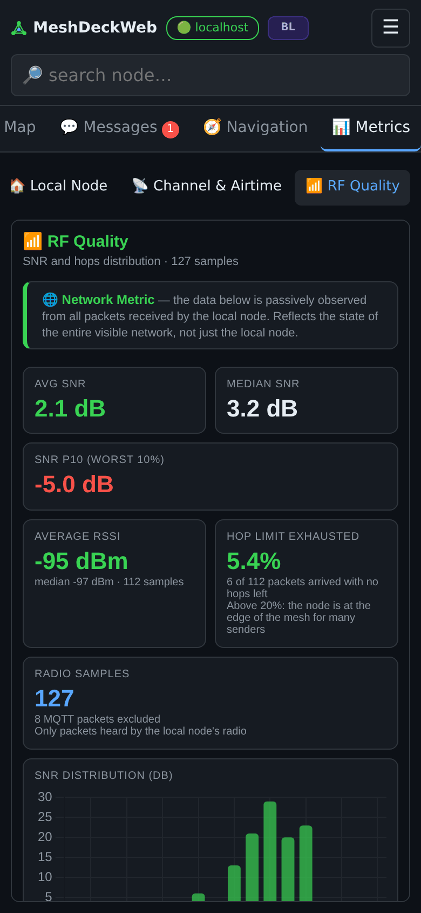
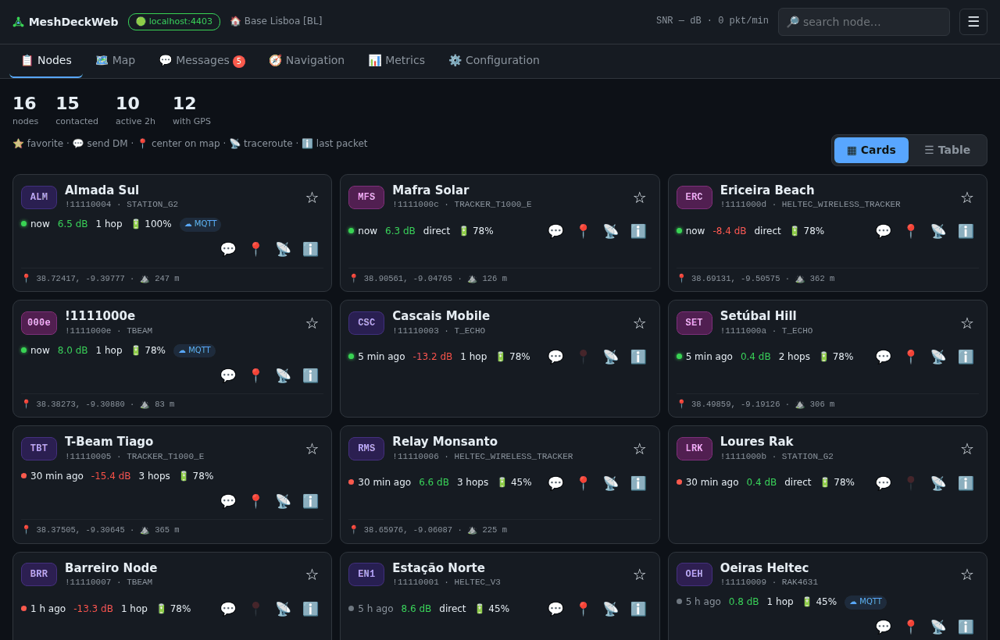
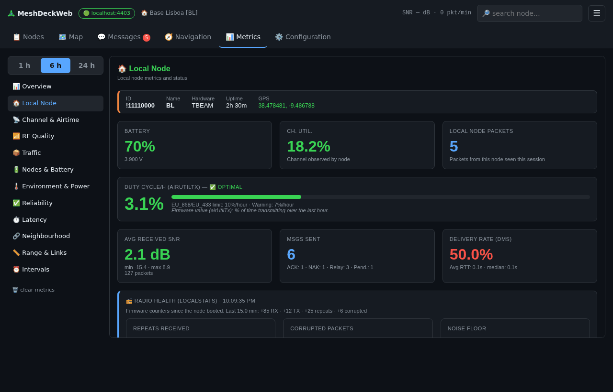
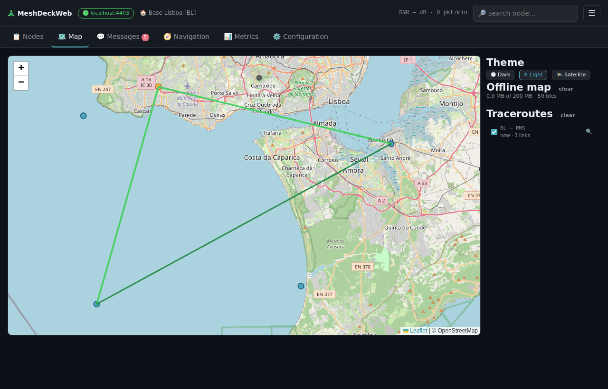

#  MeshDeckWeb

Web interface for monitoring, messaging and configuring
[Meshtastic](https://meshtastic.org) networks — from a phone, a tablet or any
browser on your network.

A small Python server keeps the connection to the node (TCP to `meshtasticd`
or direct USB Serial) and serves the interface. Built and optimised for the
**ClockworkPi uConsole CM4**, it runs on any Linux/macOS/Windows machine with
Python 3; the interface is designed for the iPhone first and works just as
well on a desktop browser.

**Version:** 2.2.0-beta &nbsp;·&nbsp; **Callsign:** CT7BRA &nbsp;·&nbsp; **Year:** 2026

> MeshDeckWeb is the web successor of [MeshDeck](https://github.com/tiuksferve/MeshDeck),
> the PyQt5 desktop application (1.x). The node logic, the configuration
> pipeline and the metrics came from it and moved to a shared core; the
> desktop window is gone. See the [CHANGELOG](CHANGELOG.md).

---

## 📸 Screenshots

<p align="center">
  
  
  
  
  
</p>
<p align="center">
  
  
  
</p>

---

## 🚀 Features

### 📋 Nodes

- Every visible node, updated live, with **favourites** (stored in the node
  firmware) pinned at the top; the **local node** sits in the header, next to
  the connection button
- **Cards** on phone and desktop, or a compact **table** on desktop
- Coloured freshness dot, SNR, hops, battery, MQTT/RF and hardware model
- Quick actions: ⭐ favourite · 💬 DM · 📍 show on map · 📡 traceroute ·
  ℹ️ last packet details
- Search by ID, long or short name

### 🗺 Map (Leaflet)

- Themes: 🌑 Dark · ☀ Light · 🛰 Satellite (hybrid, with place names and roads)
- Markers coloured by state — selected, packet just received, RF active,
  MQTT, inactive (>2 h) — with the colour legend in each node's popup
- Traceroutes with per-segment SNR, NeighborInfo links
- On phones, the theme and traceroute list open as a sheet over the map

### 💬 Messages

- Channels (indices 0–7) and direct messages, with unread counters
- DMs encrypted with **PKI** when the public key is known, **PSK** otherwise
- **Replies** (↩) using the native Meshtastic `reply_id`, shown in other apps too
- ACK/NAK per sent message, subtle tint for messages received over RF
- **Message sound**, which can be turned off per device

### 🧭 Navigation

- Compass with bearing and distance to the selected node
- **Device compass** on phones and tablets: the rose turns to true north and
  the needle points at the node, turning green when it is straight ahead
  (needs HTTPS — see below)
- Local node card with GPS refresh, and every GPS node sorted by distance,
  each with a 📍 button to open it on the map

### 📡 Traceroute

- From the node list or the map, with forward/return hops, SNR per hop and
  a "Show on map" button; 30 s between traceroutes

### ⚙️ Node Configuration

- **All 21 firmware sections**, generated from a schema checked against
  `config.proto` and `module_config.proto`
- One **transaction** per save, so the firmware reboots only once
- **Channels:** name, role, uplink/downlink, position precision and PSK — pasted
  as Base64, URL-safe Base64, `base64:` prefix or hex
- Owner (long/short name, licensed)

### 📊 Metrics (12 sections)

Charts update live, without reloading the page. The server keeps the **last
24 hours** on disk, one history per local node, so the metrics come back after
a restart; the charts show **1 h, 6 h or 24 h** (chosen per device). Message
text is never stored there.

| Section | What it measures |
|---------|-----------------|
| 📊 Overview | Packets, active nodes, SNR, hops, DM delivery rate, airtime |
| 🏠 Local Node | Battery, channel use, duty cycle/h, received SNR, messages, RTT, **radio health (LocalStats)** and **meshtasticd host (HostMetrics)** |
| 📡 Channel & Airtime | Channel utilisation and hourly duty cycle per node against the EU 10 % limit |
| 📶 RF Quality | SNR and **RSSI** from radio packets only, per-packet hops, **hop limit exhausted**, SNR × RSSI table with a noise/weak-signal hint |
| 📦 Traffic | Packets by type and over time, RF vs MQTT, direct vs relayed |
| 🔋 Nodes & Battery | Battery, voltage, uptime, hardware models, GPS |
| 🌡 Environment & Power | Temperature, humidity, pressure, air quality and INA power sensors, temperature chart |
| ✅ Reliability | DM delivery, channel messages confirmed by rebroadcast, duplicates measured by the firmware |
| ⏱ Latency | Send-to-ACK round trip: average, median, P90 |
| 🔗 Neighbourhood | NeighborInfo pairs with SNR |
| 📏 Range & Links | **Direct range** (0 hops) from the local node, **who relays the most**, NeighborInfo link distances |
| ⏰ Intervals | Average time between packets per node |

### 🔐 Access and Languages

- Password login; the session can be remembered per browser
- Protection against password guessing: after 5 failed attempts the address
  is locked out for a while (1 minute, doubling up to 15)
- Several devices at once, all in sync in real time
- English and Português, **per device**: each browser follows its own
  language and can switch in the ☰ menu without changing the others; dates
  and times follow the chosen language (and the device's region)

---

## ⚡ Quick Start

**You need:** Python 3.9 or newer, and a Meshtastic node reachable over TCP
(`meshtasticd` or a Wi-Fi node) or connected by USB.

```bash
git clone https://github.com/tiuksferve/MeshDeckWeb.git meshdeckweb
cd meshdeckweb
python3 install.py          # on Windows: py install.py
```

The installer guides you step by step:

1. Creates a Python environment (`.venv`) and installs the dependencies
2. Asks the **language**, whether to **open the server to your network** (to use
   it from your phone) and the **port**
3. Sets the **password** — yours, or a random one shown once
4. Asks **how to reach the node**: `meshtasticd` on the same machine, another
   address, a USB port (listed for you) or later in the browser
5. Optionally enables **HTTPS** for the phone compass
6. Sets the space for the **offline map** (200 MB by default)
7. Creates a **start shortcut** — `start.sh` (Linux/macOS) or `start.bat`
   (Windows) — and shows the addresses to open

From then on, start the server with:

```bash
./start.sh                  # on Windows: start.bat
```

Run `install.py` again at any time to change these settings; what is already
installed is reused.

> On Debian, Ubuntu and Raspberry Pi OS (including the uConsole), if the
> installer cannot create the environment, install `python3-venv` first:
> `sudo apt install python3-venv`.

> **macOS:** if the firewall is on, the installer offers to allow Python
> through it — otherwise the phone cannot reach the server, while `localhost`
> on the Mac still works. Set **Private Wi-Fi Address** to *Fixed*
> (Settings → Wi-Fi → Details) or reserve the IP in your router: when the IP
> changes, the server shows the new address at start and warns if the HTTPS
> certificate needs `run_server.py --make-cert`.

---

## ⚙️ Manual Installation

If you prefer to do it by hand:

```bash
git clone https://github.com/tiuksferve/MeshDeckWeb.git meshdeckweb
cd meshdeckweb
python3 -m venv .venv
source .venv/bin/activate          # on Windows: .venv\Scripts\activate
pip install -r requirements.txt
```

---

## ▶️ Running by Hand

With the `.venv` active (or through `start.sh`, which accepts the same options):

```bash
python3 run_server.py
```

On the **first run** a random password is generated and printed once in the
console — save it. To change it:

```bash
python3 run_server.py --set-password
```

By default the server only listens on `127.0.0.1:8080`. To open it to your
local network (for your phone):

```bash
python3 run_server.py --host 0.0.0.0 --port 8080
```

Then open `http://<machine-ip>:8080/` on the phone. The chosen host and port
are remembered for the next runs.

| Option | What it does |
|--------|--------------|
| `--host`, `--port` | Address and HTTP port (default `127.0.0.1:8080`, then the saved one) |
| `--connect` | Connect to the node at startup, without waiting for the browser |
| `--node-host`, `--node-port` | `meshtasticd` to connect to (default `localhost:4403`) |
| `--serial /dev/ttyACM0` | Connect over USB Serial through the built-in bridge |
| `--set-password` | Set the access password and exit |
| `--make-cert [IP …]` | Create the HTTPS certificate (see below) and exit |
| `--https-port` | HTTPS port (default `8443`) |
| `--tls-cert`, `--tls-key` | Use your own certificate instead |
| `--no-tls` | Turn HTTPS off (HTTP only) and exit |
| `--tile-cache-mb` | Space for the offline map (default `200`, `0` = keep nothing) |
| `--debug` | Detailed logging (e.g. each LocalStats received) |

> ⚠️ Anyone who logs in can reconfigure the node, channels and PSKs included.
> Only open the server to networks you trust.

---

## 🔒 HTTPS and the Device Compass

Browsers only give access to the phone's compass on **HTTPS** pages. MeshDeckWeb
serves HTTPS on a **second port**, next to plain HTTP, so devices that do not
need the compass keep using HTTP with nothing to install.

```bash
python3 run_server.py --make-cert 192.168.1.120
```

This creates a **local certificate authority (CA)** — once — and a server
certificate for the given IP, the machine's IPs and hostname. After restarting:

| Address | For |
|---------|-----|
| `http://<ip>:8080/` | Every device, no warnings |
| `https://<ip>:8443/` | Devices that want the compass |

To avoid the "connection is not private" warning, install the CA once on each
device that uses HTTPS. Regenerating the server certificate later (new IP,
expiry) keeps the CA, so devices do not need to install it again.

- **iPhone/iPad:** open `https://<ip>:8443/ca.crt` in Safari (accept the
  warning) → Settings → *Profile Downloaded* → Install → Settings → General →
  About → **Certificate Trust Settings** → turn on *MeshDeckWeb CA*.
- **Android:** download `/ca.crt` → Settings → Security → Encryption &
  credentials → Install a certificate → CA certificate.
- **PC:** import `meshdeck-ca.crt` as a trusted root certification authority,
  or accept the browser warning.

On an HTTP page, the compass button links to the HTTPS address.

---

## 🔌 USB Serial

MeshDeckWeb can talk to a Meshtastic device over USB without `meshtasticd`.
A built-in bridge (`meshtastic_bridge.py`) reads the serial stream, drops
debug noise and exposes clean frames as a local TCP server.

In the browser: **Connect** → **Serial** → pick the port (⟳ refreshes the
list) → Connect. Or at startup: `python3 run_server.py --serial /dev/ttyACM0`.

Supported USB chipsets include ESP32/S2/S3/C3, CP210x, FTDI, CH340/CH341,
PL2303 and nRF52840 (Adafruit, RAK4631). If a device does not show up, check
that the cable carries data and that your user can read the port (`dialout`
group on Linux).

Standalone bridge:

```bash
python3 meshtastic_bridge.py --list
python3 meshtastic_bridge.py --port /dev/ttyACM0 --verbose
```

> **Credits:** serial bridge concept by **[@KMX415](https://github.com/KMX415)**.

---

## 🌍 Internet Access

Everything is served by the machine itself — interface, libraries and metric
charts — so MeshDeckWeb keeps working in the field without internet.

**Offline map:** the server keeps every map tile anyone views (☀ Light and
🌑 Dark themes), so without internet the map still shows the areas already
seen — on every device. Typical use takes 20–60 MB; the limit is 200 MB by
default (`--tile-cache-mb`, also asked by the installer) and the oldest tiles
go first. The map panel shows the space used, a "no internet" note and a
button to clear it. Areas never viewed show the nodes on a blank background.

Following the OpenStreetMap tile policy, only tiles that are actually viewed
are downloaded — never whole areas in advance. The 🛰 Satellite theme (Esri)
is not stored and needs internet.

---

## 📁 Files

Settings live in `~/.config/meshdeck/` (or `$XDG_CONFIG_HOME/meshdeck/`):

| File | Contents |
|------|----------|
| `server.json` | Session key, password hash, bind address, HTTPS settings |
| `settings.json` | Server language (terminal, logs) and other preferences |
| `tls/` | Local CA and server certificate (the private keys are readable only by you) |
| `metrics/` | Metrics history of the last 24 h, one SQLite file per local node (at most 50 MB each; writing pauses when the disk has less than 100 MB free). "🗑 clear metrics" empties it |

The offline map tiles live in `~/.cache/meshdeck/tiles/` (or
`$XDG_CACHE_HOME/meshdeck/tiles/`) and can be deleted at any time.

The password is never stored in clear text. Per-device choices (sound, node
list view, metrics chart window) stay in each browser.

---

## 📁 Project Structure

```
meshdeckweb/
├── install.py             ← Guided setup (venv, password, node, HTTPS, offline map, start shortcut)
├── run_server.py          ← Entry point and command-line options
├── server/                ← Flask + Socket.IO: HTTP API, login, HTTPS, serial bridge
├── core/                  ← Node connection, nodes, messages, configuration, metrics
├── web/                   ← Browser interface (HTML, CSS, JavaScript, vendored Leaflet/Socket.IO)
├── i18n.py                ← PT/EN translations
├── constants.py           ← Version and colours
├── meshtastic_bridge.py   ← USB-to-TCP serial bridge
├── docs/screenshots/      ← README images (en/pt)
├── tests/                 ← pytest suite
├── requirements.txt
└── THIRD_PARTY_NOTICES.md ← Licenses of the bundled libraries and dependencies
```

Run the tests with:

```bash
pip install pytest
python3 -m pytest                 # everything (about 1 min on a uConsole CM4)
python3 -m pytest -m "not ui"     # without the browser tests
```

The tests in `tests/ui/` open the real interface in a headless Chromium or
Chrome, with simulated nodes, messages and metrics and no internet: login,
every tab on desktop and phone sizes, map, compass, messages, the 12 metric
sections, node configuration and the language switch. They are skipped when
no Chromium/Chrome is installed (`MESHDECK_BROWSER=/path/to/browser` picks
one). A failing test leaves a screenshot in `.pytest_cache/ui-failures/`.

---

## 📡 Meshtastic Firmware Requirements

| Feature | Minimum version |
|---------|----------------|
| PKI DMs (end-to-end encrypted) | 2.3.0 |
| Firmware-managed favourites | 2.3.0 |
| Per-packet hops, LocalStats | 2.3.0 |
| Traceroute with SNR | 2.3.2 |
| NeighborInfo over LoRa | 2.5.13 |
| Relayer of each packet ("who relays the most") | 2.6.0 |

---

## 🧑‍💻 Developed by

**CT7BRA — Tiago Veiga**  
Python 3 · Flask · Socket.IO · Meshtastic · Leaflet · Chart.js  
Optimised for the ClockworkPi uConsole CM4 · 2026

---

## 🤝 Credits

| Contributor | Contribution |
|-------------|-------------|
| [@KMX415](https://github.com/KMX415) | Original serial bridge concept and code |

---

## 🤖 A Note on Artificial Intelligence

This project was developed with the support of **Claude** (Anthropic). The AI
contributed across many sessions — from the original desktop app (metrics,
configuration pipeline, navigation, serial bridge, translations) to the web
version: the shared core, the server, the browser interface, HTTPS, the
metrics review and the new metrics.

The code was reviewed, tested and validated by the author on real hardware
(ClockworkPi uConsole CM4 and an iPhone) with a live Meshtastic network.

---

## 📄 License

MeshDeckWeb is released under the [MIT License](LICENSE). The bundled
libraries (Chart.js, Leaflet, Socket.IO) and the Python dependencies keep their
own licenses, listed in [THIRD_PARTY_NOTICES.md](THIRD_PARTY_NOTICES.md).

Meshtastic® is a registered trademark of Meshtastic LLC. MeshDeckWeb is an
independent project, not affiliated with or endorsed by Meshtastic LLC.
