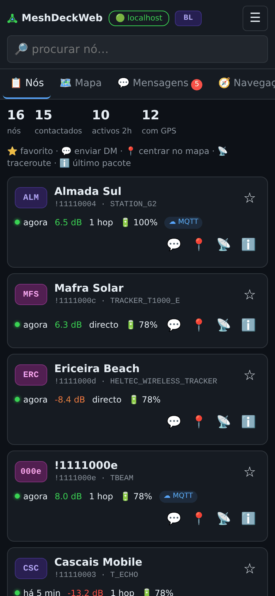
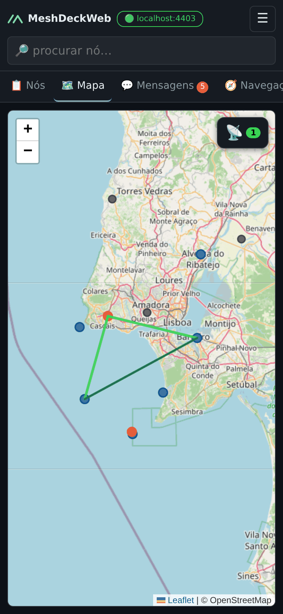
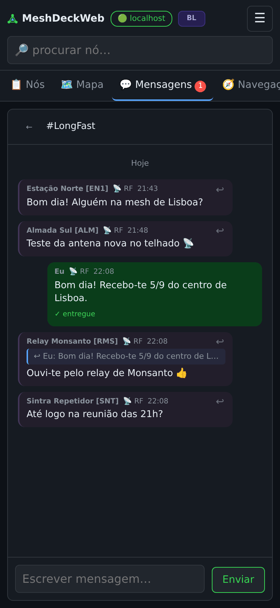
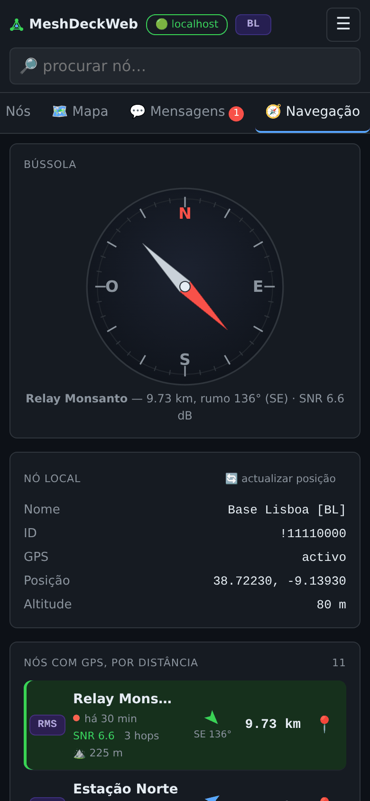
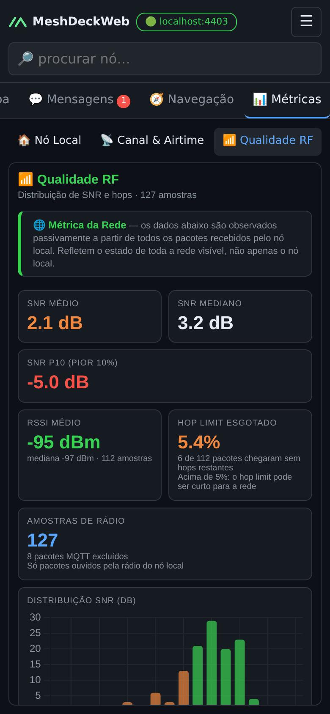
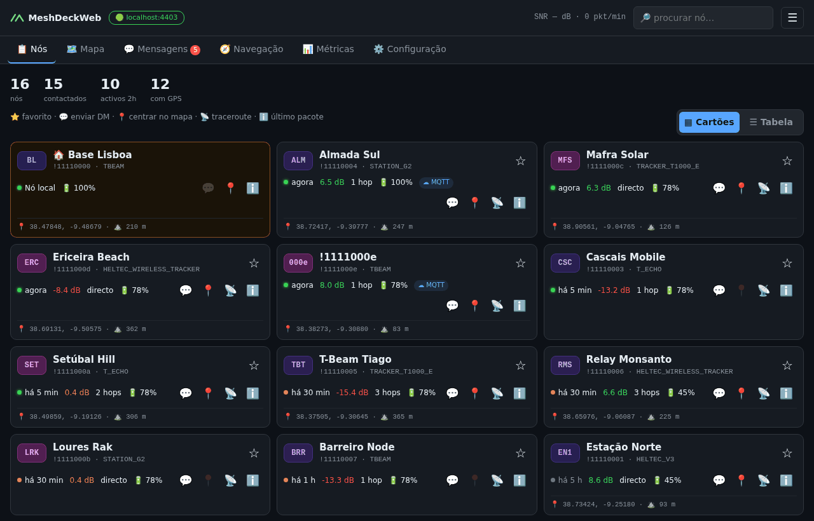
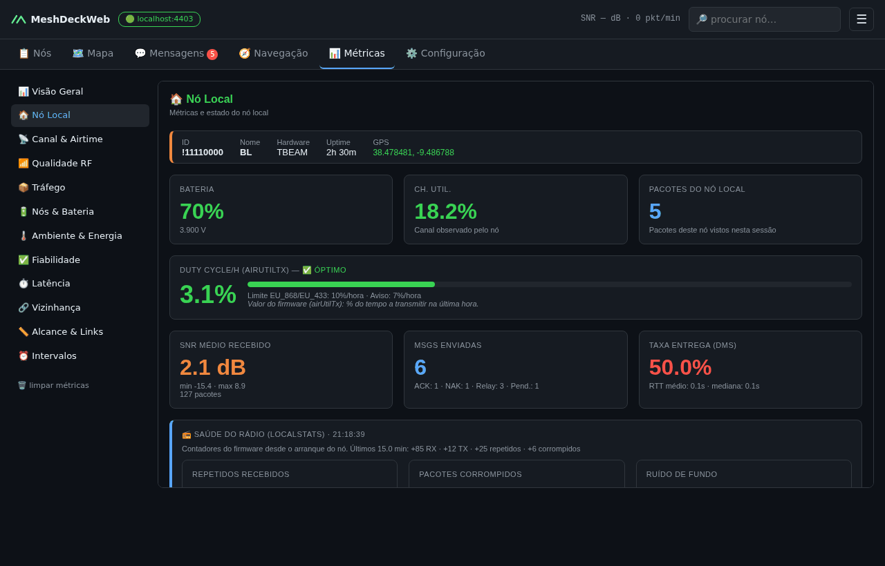
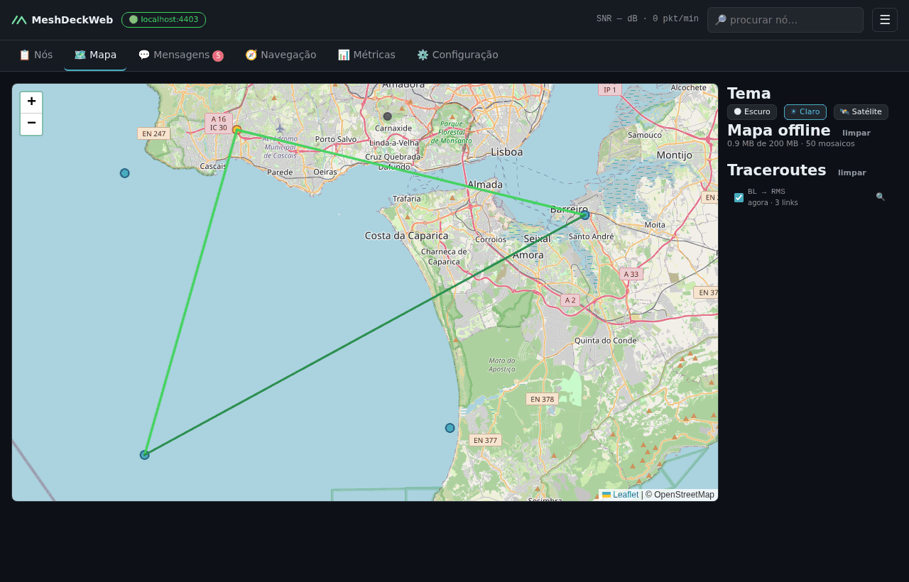

# 📡 MeshDeckWeb

Interface web para monitorizar, comunicar e configurar redes
[Meshtastic](https://meshtastic.org) — a partir do telemóvel, de um tablet ou
de qualquer browser na sua rede.

Um pequeno servidor em Python mantém a ligação ao nó (TCP ao `meshtasticd` ou
USB Serial directo) e serve a interface. Desenvolvido e optimizado para o
**ClockworkPi uConsole CM4**, funciona em qualquer máquina Linux/macOS/Windows
com Python 3; a interface foi pensada primeiro para o iPhone e funciona
igualmente bem num browser de computador.

**Versão:** 2.0.0-beta &nbsp;·&nbsp; **Callsign:** CT7BRA &nbsp;·&nbsp; **Ano:** 2026

> O MeshDeckWeb é o sucessor web do [MeshDeck](https://github.com/tiuksferve/MeshDeck),
> a aplicação desktop em PyQt5 (1.x). A lógica do nó, a escrita da
> configuração e as métricas vieram dele e passaram para um núcleo partilhado;
> a janela desktop deixou de existir. Ver o [CHANGELOG](CHANGELOG.md).

---

## 📸 Capturas de Ecrã

<p align="center">
  
  
  
  
  
</p>
<p align="center">
  
  
  
</p>

---

## 🚀 Funcionalidades

### 📋 Nós

- Todos os nós visíveis, actualizados em tempo real, com o **nó local** e os
  **favoritos** (guardados no firmware do nó) fixos no topo
- **Cartões** no telemóvel e no computador, ou uma **tabela** compacta no computador
- Ponto de frescura colorido, SNR, hops, bateria, MQTT/RF e modelo de hardware
- Acções rápidas: ⭐ favorito · 💬 DM · 📍 ver no mapa · 📡 traceroute ·
  ℹ️ detalhe do último pacote
- Pesquisa por ID, nome longo ou nome curto

### 🗺 Mapa (Leaflet)

- Temas: 🌑 Escuro · ☀ Claro · 🛰 Satélite (híbrido, com localidades e estradas)
- Marcadores coloridos por estado — seleccionado, pacote acabado de receber,
  RF activo, MQTT, inactivo (>2 h) — com a legenda da cor no popup de cada nó
- Traceroutes com SNR por segmento, ligações NeighborInfo
- No telemóvel, o tema e a lista de traceroutes abrem numa folha sobre o mapa

### 💬 Mensagens

- Canais (índices 0–7) e mensagens directas, com contadores de não lidas
- DMs cifradas com **PKI** quando a chave pública é conhecida, **PSK** caso contrário
- **Respostas** (↩) com o `reply_id` nativo do Meshtastic, visíveis também noutras apps
- ACK/NAK por mensagem enviada, tom discreto nas mensagens recebidas por RF
- **Som de mensagem**, que pode ser desligado em cada dispositivo

### 🧭 Navegação

- Bússola com rumo e distância até ao nó seleccionado
- **Bússola do dispositivo** em telemóveis e tablets: a rosa roda para o norte
  real e a agulha aponta para o nó, ficando verde quando está em frente
  (requer HTTPS — ver abaixo)
- Cartão do nó local com actualização do GPS, e todos os nós com GPS ordenados
  por distância, cada um com um botão 📍 para o abrir no mapa

### 📡 Traceroute

- A partir da lista de nós ou do mapa, com hops de ida e volta, SNR por hop e
  botão "Mostrar no Mapa"; 30 s entre traceroutes

### ⚙️ Configuração do Nó

- **As 21 secções do firmware**, geradas a partir de um esquema validado contra
  o `config.proto` e o `module_config.proto`
- Uma **transacção** por gravação, para o firmware reiniciar uma só vez
- **Canais:** nome, papel, uplink/downlink, precisão da posição e PSK — colada
  em Base64, Base64 URL-safe, com prefixo `base64:` ou em hex
- Dono (nome longo/curto, licenciado)

### 📊 Métricas (12 secções)

Os gráficos actualizam-se em tempo real, sem recarregar a página.

| Secção | O que mede |
|--------|-----------|
| 📊 Visão Geral | Pacotes, nós activos, SNR, hops, taxa de entrega de DMs, airtime |
| 🏠 Nó Local | Bateria, uso do canal, duty cycle/h, SNR recebido, mensagens, RTT, **saúde do rádio (LocalStats)** e **máquina do meshtasticd (HostMetrics)** |
| 📡 Canal & Airtime | Utilização do canal e duty cycle horário por nó face ao limite UE de 10 % |
| 📶 Qualidade RF | SNR e **RSSI** só de pacotes de rádio, hops por pacote, **hop limit esgotado**, tabela SNR × RSSI com indicação de ruído/sinal fraco |
| 📦 Tráfego | Pacotes por tipo e por minuto, RF vs MQTT, directos vs retransmitidos |
| 🔋 Nós & Bateria | Bateria, tensão, uptime, modelos de hardware, GPS |
| 🌡 Ambiente & Energia | Temperatura, humidade, pressão, qualidade do ar e sensores de energia INA, gráfico de temperatura |
| ✅ Fiabilidade | Entrega de DMs, mensagens de canal confirmadas por retransmissão, duplicados medidos pelo firmware |
| ⏱ Latência | Tempo de ida e volta até ao ACK: média, mediana, P90 |
| 🔗 Vizinhança | Pares NeighborInfo com SNR |
| 📏 Alcance & Links | **Alcance directo** (0 hops) a partir do nó local, **quem mais retransmite**, distâncias dos links NeighborInfo |
| ⏰ Intervalos | Tempo médio entre pacotes por nó |

### 🔐 Acesso e Idiomas

- Login com password; a sessão pode ficar lembrada em cada browser
- Protecção contra tentativas de adivinhar a password: ao fim de 5 falhas o
  endereço fica bloqueado durante algum tempo (1 minuto, a dobrar até 15)
- Vários dispositivos ao mesmo tempo, todos sincronizados em tempo real
- Português e English, escolhidos no menu ☰

---

## ⚡ Início Rápido

**Precisa de:** Python 3.9 ou mais recente, e um nó Meshtastic acessível por
TCP (`meshtasticd` ou um nó Wi-Fi) ou ligado por USB.

```bash
git clone https://github.com/tiuksferve/MeshDeckWeb.git meshdeckweb
cd meshdeckweb
python3 install.py          # no Windows: py install.py
```

O instalador guia-o passo a passo:

1. Cria um ambiente Python (`.venv`) e instala as dependências
2. Pergunta o **idioma**, se quer **abrir o servidor à rede** (para o usar no
   telemóvel) e a **porta**
3. Define a **password** — a sua, ou uma aleatória mostrada uma vez
4. Pergunta **como chegar ao nó**: `meshtasticd` na mesma máquina, outro
   endereço, uma porta USB (mostra-lhe a lista) ou mais tarde no browser
5. Activa opcionalmente o **HTTPS** para a bússola do telemóvel
6. Define o espaço para o **mapa offline** (200 MB por omissão)
7. Cria um **atalho de arranque** — `start.sh` (Linux/macOS) ou `start.bat`
   (Windows) — e mostra os endereços a abrir

A partir daí, arranque o servidor com:

```bash
./start.sh                  # no Windows: start.bat
```

Pode correr o `install.py` outra vez quando quiser mudar estas definições; o
que já está instalado é reaproveitado.

> No Debian, Ubuntu e Raspberry Pi OS (incluindo o uConsole), se o instalador
> não conseguir criar o ambiente, instale primeiro o `python3-venv`:
> `sudo apt install python3-venv`.

---

## ⚙️ Instalação Manual

Se preferir fazer à mão:

```bash
git clone https://github.com/tiuksferve/MeshDeckWeb.git meshdeckweb
cd meshdeckweb
python3 -m venv .venv
source .venv/bin/activate          # no Windows: .venv\Scripts\activate
pip install -r requirements.txt
```

---

## ▶️ Arranque Manual

Com o `.venv` activo (ou através do `start.sh`, que aceita as mesmas opções):

```bash
python3 run_server.py
```

Na **primeira execução** é gerada uma password aleatória, mostrada uma única
vez no console — guarde-a. Para a trocar:

```bash
python3 run_server.py --set-password
```

Por omissão o servidor só escuta em `127.0.0.1:8080`. Para o abrir à rede
local (para o telemóvel):

```bash
python3 run_server.py --host 0.0.0.0 --port 8080
```

Depois abra `http://<ip-da-máquina>:8080/` no telemóvel. O endereço e a porta
escolhidos ficam guardados para as execuções seguintes.

| Opção | O que faz |
|-------|-----------|
| `--host`, `--port` | Endereço e porta HTTP (por omissão `127.0.0.1:8080`, depois os guardados) |
| `--connect` | Ligar ao nó no arranque, sem esperar pelo browser |
| `--node-host`, `--node-port` | `meshtasticd` a que ligar (por omissão `localhost:4403`) |
| `--serial /dev/ttyACM0` | Ligar por USB Serial através da ponte incluída |
| `--set-password` | Definir a password de acesso e sair |
| `--make-cert [IP …]` | Criar o certificado HTTPS (ver abaixo) e sair |
| `--https-port` | Porta HTTPS (por omissão `8443`) |
| `--tls-cert`, `--tls-key` | Usar um certificado próprio |
| `--no-tls` | Desligar o HTTPS (só HTTP) e sair |
| `--tile-cache-mb` | Espaço para o mapa offline (por omissão `200`, `0` = não guardar) |
| `--debug` | Registo detalhado (por exemplo, cada LocalStats recebido) |

> ⚠️ Quem entrar pode reconfigurar o nó, incluindo canais e PSK. Abra o
> servidor só a redes de confiança.

---

## 🔒 HTTPS e a Bússola do Dispositivo

Os browsers só dão acesso à bússola do telemóvel em páginas **HTTPS**. O
MeshDeckWeb serve HTTPS numa **segunda porta**, ao lado do HTTP, para os
dispositivos que não precisam da bússola continuarem em HTTP sem instalar nada.

```bash
python3 run_server.py --make-cert 192.168.1.120
```

Isto cria uma **autoridade de certificação (CA) local** — uma só vez — e um
certificado do servidor para o IP indicado, os IPs da máquina e o nome dela.
Depois de reiniciar:

| Endereço | Para |
|----------|------|
| `http://<ip>:8080/` | Todos os dispositivos, sem avisos |
| `https://<ip>:8443/` | Dispositivos que querem a bússola |

Para não ver o aviso "esta ligação não é privada", instale a CA uma vez em cada
dispositivo que use HTTPS. Gerar de novo o certificado do servidor (outro IP,
validade a terminar) mantém a CA, por isso os dispositivos não precisam de a
voltar a instalar.

- **iPhone/iPad:** abra `https://<ip>:8443/ca.crt` no Safari (aceite o aviso)
  → Definições → *Perfil descarregado* → Instalar → Definições → Geral →
  Informações → **Definições de confiança de certificados** → active
  *MeshDeckWeb CA*.
- **Android:** descarregue `/ca.crt` → Definições → Segurança → Encriptação e
  credenciais → Instalar certificado → Certificado de CA.
- **PC:** importe `meshdeck-ca.crt` como autoridade de certificação de raiz
  fidedigna, ou aceite o aviso do browser.

Numa página HTTP, o botão da bússola mostra a ligação para o endereço HTTPS.

---

## 🔌 USB Serial

O MeshDeckWeb comunica com um dispositivo Meshtastic por USB sem precisar do
`meshtasticd`. Uma ponte incluída (`meshtastic_bridge.py`) lê o fluxo série,
descarta o ruído de depuração e expõe os frames limpos num servidor TCP local.

No browser: **Conectar** → **Serial** → escolha a porta (⟳ actualiza a lista)
→ Conectar. Ou no arranque: `python3 run_server.py --serial /dev/ttyACM0`.

Os chipsets USB suportados incluem ESP32/S2/S3/C3, CP210x, FTDI, CH340/CH341,
PL2303 e nRF52840 (Adafruit, RAK4631). Se um dispositivo não aparecer,
confirme que o cabo transmite dados e que o seu utilizador pode ler a porta
(grupo `dialout` no Linux).

Ponte isolada:

```bash
python3 meshtastic_bridge.py --list
python3 meshtastic_bridge.py --port /dev/ttyACM0 --verbose
```

> **Créditos:** conceito da ponte série de **[@KMX415](https://github.com/KMX415)**.

---

## 🌍 Acesso à Internet

Tudo é servido pela própria máquina — interface, bibliotecas e gráficos das
métricas — por isso o MeshDeckWeb continua a funcionar no campo sem internet.

**Mapa offline:** o servidor guarda cada mosaico do mapa que alguém vê (temas
☀ Claro e 🌑 Escuro), por isso sem internet o mapa continua a mostrar as zonas
já vistas — em todos os dispositivos. O uso típico ocupa 20–60 MB; o limite é
de 200 MB por omissão (`--tile-cache-mb`, também perguntado pelo instalador) e
os mosaicos mais antigos saem primeiro. O painel do mapa mostra o espaço usado,
um aviso "sem internet" e um botão para limpar. As zonas nunca vistas mostram
os nós sobre um fundo vazio.

Seguindo as regras do OpenStreetMap, só se descarregam os mosaicos que são de
facto vistos — nunca zonas inteiras de antemão. O tema 🛰 Satélite (Esri) não é
guardado e precisa de internet.

---

## 📁 Ficheiros

As preferências ficam em `~/.config/meshdeck/` (ou `$XDG_CONFIG_HOME/meshdeck/`):

| Ficheiro | Conteúdo |
|----------|----------|
| `server.json` | Chave de sessão, hash da password, endereço, definições HTTPS |
| `settings.json` | Idioma e outras preferências |
| `tls/` | CA local e certificado do servidor (as chaves privadas só são legíveis por si) |

Os mosaicos do mapa offline ficam em `~/.cache/meshdeck/tiles/` (ou
`$XDG_CACHE_HOME/meshdeck/tiles/`) e podem ser apagados a qualquer momento.

A password nunca fica guardada em claro. As escolhas de cada dispositivo (som,
vista da lista de nós) ficam no respectivo browser.

---

## 📁 Estrutura do Projecto

```
meshdeckweb/
├── install.py             ← Instalação guiada (venv, password, nó, HTTPS, mapa offline, atalho)
├── run_server.py          ← Ponto de entrada e opções da linha de comandos
├── server/                ← Flask + Socket.IO: API HTTP, login, HTTPS, ponte série
├── core/                  ← Ligação ao nó, nós, mensagens, configuração, métricas
├── web/                   ← Interface do browser (HTML, CSS, JavaScript, Leaflet/Socket.IO incluídos)
├── i18n.py                ← Traduções PT/EN
├── constants.py           ← Versão e cores
├── meshtastic_bridge.py   ← Ponte série USB → TCP
├── docs/screenshots/      ← Imagens dos READMEs (en/pt)
├── tests/                 ← Testes (pytest)
└── requirements.txt
```

Para correr os testes:

```bash
pip install pytest
python3 -m pytest
```

---

## 📡 Requisitos de Firmware Meshtastic

| Funcionalidade | Versão mínima |
|----------------|---------------|
| DMs PKI (cifradas ponta a ponta) | 2.3.0 |
| Favoritos geridos no firmware | 2.3.0 |
| Hops por pacote, LocalStats | 2.3.0 |
| Traceroute com SNR | 2.3.2 |
| NeighborInfo por LoRa | 2.5.13 |
| Retransmissor de cada pacote ("quem mais retransmite") | 2.6.0 |

---

## 🧑‍💻 Desenvolvido por

**CT7BRA — Tiago Veiga**  
Python 3 · Flask · Socket.IO · Meshtastic · Leaflet · Chart.js  
Optimizado para o ClockworkPi uConsole CM4 · 2026

---

## 🤝 Créditos

| Contribuidor | Contribuição |
|--------------|-------------|
| [@KMX415](https://github.com/KMX415) | Conceito e código original da ponte série |

---

## 🤖 Nota sobre Inteligência Artificial

Este projecto foi desenvolvido com o apoio do **Claude** (Anthropic). A IA
contribuiu ao longo de muitas sessões — da aplicação desktop original
(métricas, escrita da configuração, navegação, ponte série, traduções) à versão
web: o núcleo partilhado, o servidor, a interface do browser, o HTTPS, a
revisão das métricas e as métricas novas.

O código foi revisto, testado e validado pelo autor em hardware real
(ClockworkPi uConsole CM4 e iPhone) com uma rede Meshtastic activa.
